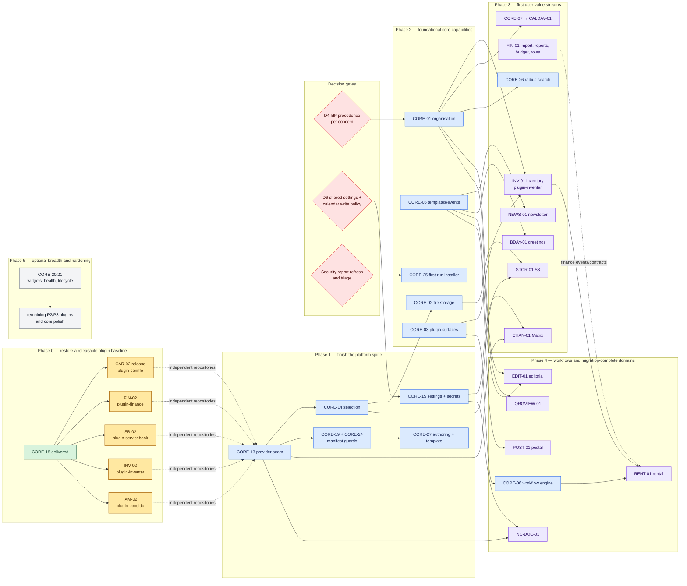

# ClubGear roadmap

Audience: Maintainers deciding what to build next across the core and plugin repositories
Scope: Prioritised programme view derived from the canonical backlog; no item is defined here
Last-Validated: 2026-10-02

This is the single graphical roadmap for ClubGear. Item status, scope and ownership remain
canonical in [`core-platform.md`](core-platform.md), [`core-capabilities.md`](core-capabilities.md)
and [`plugins.md`](plugins.md). Dependency detail remains in [`domains.md`](domains.md). This page
selects a practical order from those dependencies.

## Reading the roadmap

- A solid arrow is a required dependency. A dotted arrow marks a useful integration, not a release
  prerequisite.
- Nodes sharing a phase may run in parallel only when they own different repositories or do not
  overlap files. Every implementation run still owns exactly one repository.
- `P0/P1/P2/P3` are backlog priorities, not estimates. No dates are implied.
- Delivered items appear only where they explain why current work is ready.

## Programme roadmap

## Execution order

### Now — restore compatibility and close release residue

Run the five plugin repositories independently. CarInfo needs only the deliberate `1.0.10` release
and updated core gitlink; Finance, ServiceBook, Inventar and IamOidc still need contract `1.13.0`
adoption and their own releases. These runs may proceed in parallel because they share no writer.
Do not combine them into a core commit.

### Next — platform spine

1. **CORE-13 + CORE-14** in one core run: provider consumption, collision handling and explicit
   provider selection.
2. **CORE-15** may run in parallel after its D6 ownership/read/uninstall decisions are recorded.
3. **CORE-19 + CORE-24** after CORE-13: manifest category/kind and consistency checks.
4. **CORE-27** after CORE-19: restructure the authoring guidance and publish a rule-compliant plugin
   project template only after the manifest vocabulary is settled.

This phase is the highest leverage: it unlocks channel, storage, document and API-key plugins and
prevents each integration from inventing configuration and precedence rules.

### Then — capability foundations in parallel

- **CORE-01** after the D4 authority decision; it has the widest fan-out.
- **CORE-05** immediately; it unlocks newsletter, postal and birthday automation.
- **CORE-02** after CORE-14.
- **CORE-03** can proceed incrementally, tied to named consumers.
- **CORE-25** can proceed independently, but only after a fresh security triage establishes the
  bootstrap threat model. It combines the old twelve-slice install plan into one canonical item.

### Product streams

Choose at least one stream after the foundations rather than starting every plugin at once:

| Stream | Minimum chain | Repository sequence |
|---|---|---|
| Inventory and rental | CORE-01 + CORE-02 + CORE-03 → INV-01 → CORE-06 → RENT-01 | core → `plugin-inventar` → core → `plugin-rental` |
| Finance completion | FIN-02 → FIN-01 | `plugin-finance` only; split imports, reporting/budget and roles into bounded runs |
| Communication | CORE-05 + CORE-13/15 → NEWS-01 / CHAN-01 / POST-01 / BDAY-01 | core, then one plugin repository per run |
| Organisation and calendar | D4 → CORE-01 → CORE-07 → CALDAV-01; CORE-26 and ORGVIEW-01 branch after CORE-01 | core → `plugin-caldav`; side branches may run in parallel |
| Files and documents | CORE-14 → CORE-02 → STOR-01; CORE-13/15 → NC-DOC-01 | core, then independent provider repositories |

## Decisions and gates

Before work reaches the affected node, record these decisions in the architecture decision record:

1. **Identity authority (D4):** precedence per member field, permission and organisation unit;
   rejected local edits; local-only fallback.
2. **Shared settings (D6):** ownership, read scope, encryption, uninstall semantics and whether
   managed calendars are member-readable or writable.
3. **Installer security:** bootstrap authentication, post-install route behaviour, registration
   before installation, concurrency/transaction boundary and audit record.
4. **Finance compatibility:** whether `kassenwart` remains a permanent persisted permission alias and
   when legacy command aliases may be removed.
5. **Security evidence:** the 2026-08 scan is historical. Re-run supported scanners against HEAD,
   classify only reproducible findings, and never schedule raw scanner output as fact.

## Intentionally deferred

P2/P3 breadth—dashboard widgets, plugin health/data lifecycle, API-key extraction, Telegram,
WhatsApp, SMS, Listmonk, Traccar, CMS, document compendium, decision trees, CarInfo field residue,
ServiceBook parity and IAM mapping—stays visible in the canonical item files but does not interrupt
the platform spine or the first selected product stream.
